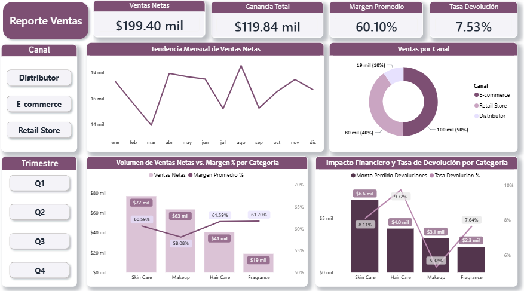

# 💄 Aura Beauty Co. - Dashboard de Ventas Omnicanal y Análisis de Devoluciones

## 📌 Resumen del Proyecto
Este proyecto analiza el rendimiento comercial de **Aura Beauty Co.**, una empresa de productos cosméticos con modelo de venta omnicanal (Retail, E-commerce y Distribuidores). El objetivo principal es optimizar las ventas y el margen de ganancia por canal y categoría de producto, identificando al mismo tiempo el impacto financiero directo que tienen las devoluciones sobre la rentabilidad del negocio.

---

## 📊 Vistas del Dashboard


---

## 🎯 Preguntas de Negocio Respondidas

1. **Rendimiento por Categoría:** ¿Qué categoría (*Skin Care, Makeup, Hair Care, Fragrance*) genera el mayor volumen de ventas vs. mayor margen de beneficio?
2. **Comparativa de Canales:** ¿Cómo varían los ingresos y la efectividad entre la Tienda Física (Retail), E-commerce y Distribuidores?
3. **Impacto Financiero de Devoluciones:** ¿Cuánto dinero se pierde en devoluciones por categoría y cuál presenta la mayor tasa de devolución porcentual?

---

## 💡 Hallazgos Clave (Insights de Negocio)

### 1. Salud Financiera y Comportamiento Omnicanal
* **Desempeño Global:** Se registra un volumen de ventas netas de **$199.40 mil**, con una ganancia total de **$119.84 mil** y un margen promedio saludable del **60.10%**.
* **Dominio del Canal Digital:** El canal **E-commerce lidera las ventas con el 50% del total ($100 mil)**, seguido de las tiendas físicas (**Retail Store con $80 mil / 40%**). El canal de **Distribuidores tiene una participación marginal ($19 mil / 10%)**.
* **Estacionalidad de Ventas:** La tendencia mensual muestra caídas marcadas en **marzo (~$14 mil)**, **julio** y **septiembre (~$15.2 mil)**, contrastando con picos de facturación en **abril**, **agosto** y **noviembre (~$17.5 mil - $18.5 mil)**.

### 2. Análisis por Categoría (Volumen vs. Rentabilidad)
* **Skin Care como Motor Comercial:** Aporta el mayor volumen de ingresos al negocio (**$77 mil**) manteniendo un margen alineado al promedio (**60.59%**).
* **Makeup Diluye el Margen:** Representa la segunda categoría en ingresos (**$63 mil**), pero registra el **margen de ganancia más bajo del catálogo (58.08%)**.
* **Oportunidad en Fragrance y Hair Care:** Presentan los márgenes más altos (**61.70% y 61.59%** respectivamente), aunque **Fragrance se encuentra subexplotada en volumen de ventas ($19 mil)**.

### 3. Fuga Financiera por Devoluciones
* **Fuga Global:** La tasa global de devolución se ubica en **7.53%**, representando una pérdida directa de margen neto.
* **Skin Care Lidera las Pérdidas Monetarias:** Genera la mayor pérdida en dinero por devoluciones (**$6.6 mil perdidos**) con una tasa del **8.11%**.
* **Hair Care con la Tasa más Crítica:** Registra la mayor tasa de devolución del catálogo (**9.72%**), representando **$4.0 mil perdidos**.
* **Makeup es la más Estable:** Pese a su menor margen, es la línea con menor tasa de devolución (**5.32%**, $3.1 mil perdidos).

---

## 🚀 Recomendaciones Estratégicas

1. **Intervención Operativa en Hair Care y Skin Care:**
   * Auditar causas raíz de devolución en E-commerce (posibles problemas de sellado/empaque en envíos o discrepancias en la descripción del producto).
   * Optimizar las fichas de producto e incluir guías claras de uso para reducir la insatisfacción del cliente.
2. **Optimización del Margen en Makeup:**
   * Revisar costos de adquisición o reducir descuentos directos aplicados a esta línea para elevar su margen (58.08%) al promedio general (~60%).
3. **Estrategia de Venta Cruzada (Fragrance):**
   * Aprovechar el elevado margen de *Fragrance* (61.70%) creando paquetes promocionales (*bundles*) junto a productos estrella de *Skin Care* en E-commerce.
4. **Plan para Estacionalidad Baja:**
   * Diseñar campañas de lealtad y promociones estratégicas para amortiguar los valles de venta identificados en marzo, julio y septiembre.
5. **Reevaluación del Canal Distribuidores:**
   * Evaluar si el margen neto aportado por el canal de Distribuidores ($19 mil / 10%) justifica la carga logística, o si conviene reasignar recursos para potenciar E-commerce y Retail.

---

## 🛠️ Tecnologías Utilizadas

* **Python (Pandas, NumPy):** Limpieza, imputación de nulos y estructuración del conjunto de datos.
* **Power BI Desktop:** Modelado de datos, diseño de interfaz y arquitectura visual.
* **DAX (Data Analysis Expressions):** Creación de medidas dinámicas de ventas netas, márgenes porcentuales y tasa de devoluciones.

---

## 📐 Medidas Clave en DAX

```dax
// 1. Ventas Netas Totales
Ventas Netas = SUM(Ventas[Venta_Neta])

// 2. Ganancia Total
Ganancia Total = SUM(Ventas[Ganancia_Bruta])

// 3. Tasa de Devolución (%)
Tasa Devolución % = 
DIVIDE(
    CALCULATE(COUNTROWS(Ventas), Ventas[Devuelto] = 1),
    COUNTROWS(Ventas),
    0
)

// 4. Monto Perdido por Devoluciones
Monto Perdido Devoluciones = 
SUMX(
    FILTER(Ventas, Ventas[Devuelto] = 1),
    Ventas[Venta_Neta]
)

---

## 📂 Estructura del Proyecto

├── assets/                          # Imágen y capturas del dashboard
│   └── dashboard_overview.png
├── data/                            # Dataset limpio para análisis
│   └── ventas_cosmeticos_limpio.csv
├── notebooks/                       # Pipeline de preparación y limpieza
│   └── data_cleaning_and_prep.ipynb
├── dashboard/                       # Reporte en Power BI
│   └── aura_beauty_sales_report.pbix
├── .gitignore
└── README.md